# XPS → PMX 使用说明

> 截图用的是 Blender 3.6.15 的默认界面，示例模型是 rouffe。这个模型有两组重名骨，正好能演示体检和修正怎么用。你的界面缩放、侧栏宽度不同的话，布局会略有差别。图里的红框编号和正文里的 ①②③ 一一对应。
>
> 截图由 `scripts/make_guide_screenshots.py` 自动生成，界面改了以后重跑它即可，见 README「重新生成使用说明的截图」。

平时只用三个按钮：**一键转换** → 看**体检报告** → 需要时勾上修正、点**按修正从头重做**。下面按顺序走一遍。

## 0. 启用插件（只做一次）

先按 README 的「安装」把插件放进 Blender 3.6 的插件目录，mmd_tools 1.0.2 也要装上。

1. 打开 编辑 → 偏好设置 → 插件，搜索「XPS →」，勾选 **Import-Export: XPS → PMX**（①）。
2. 再搜索「mmd」，勾选 mmd_tools。没勾的话，转换到 ④ 时插件会临时启用它。
3. 展开 XPS → PMX 的插件设置，「PMX 输出根目录」默认是 `D:\xps_exports`，可以改。

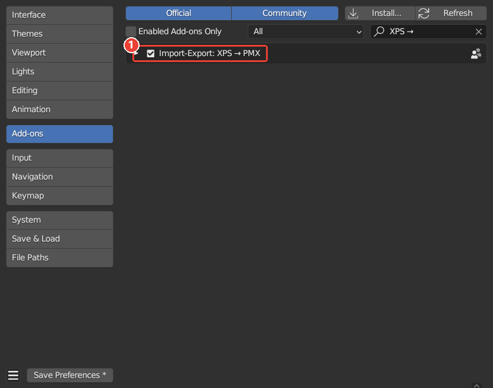

## 1. 打开侧栏，选文件

1. 在 3D 视图里按 **N** 打开右侧侧栏，点竖排的 **XPS→PMX** 页签（①）。
2. 在路径框里填 XPS 文件（②）。可以点右边的文件夹图标浏览，也可以直接粘贴路径。支持 `.xps`、`.mesh`、`.mesh.ascii`。
3. 点 **一键转换**（③）。

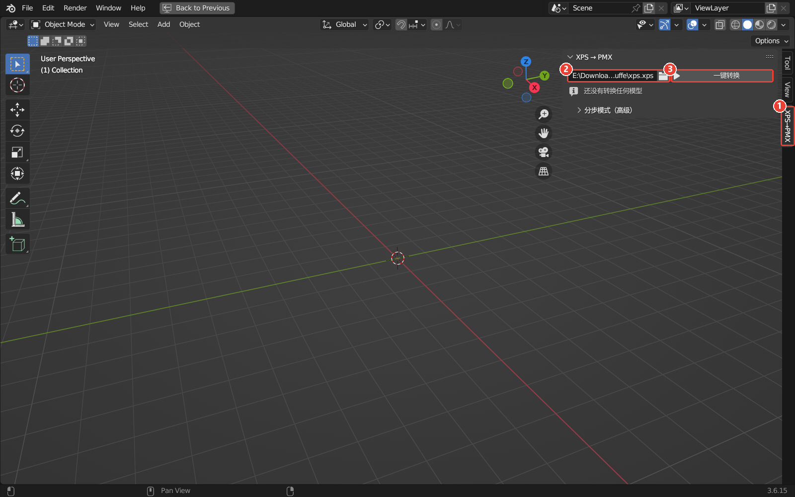

转换会依次做完 ① 导入、② 识别、③ 预处理、④ 生成骨架、⑧ 导出、⑨ 体检。这期间 Blender 不响应操作：5 万顶点的模型十几秒，25 万顶点的要一两分钟。

## 2. 看体检报告

转换完，主面板中间就是体检报告：

- ① **计数**：✗ 错误、⚠ 警告、ℹ 提示。有自动修正或者比上次修好了，后面还会写「已自动修正 n」「比上次修好 n」。
- ② **结果列表**：每行写着部位（躯干、左臂、衣物与其他……）和一句话说明。右边的按钮依次是：
  - 勾选框：这条有修正时才有；
  - 放大镜：在视口里选中相关的骨；
  - 眼睛：忽略，以后不再报。
- ③ **详情**：选中那一行的完整说明，见下一节。
- ④ **三个按钮**：按修正从头重做、分步重做、继续。

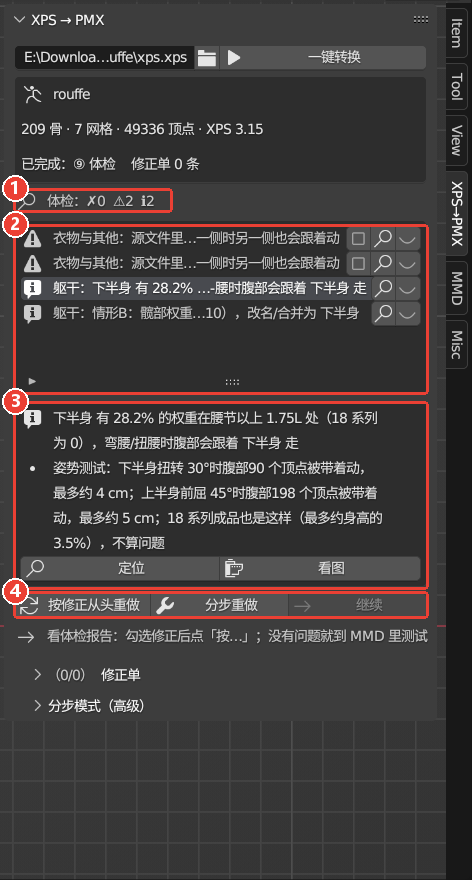

这时 PMX 已经导出好了，位置见第 6 节。报告里没有 ✗ 和 ⚠，就可以直接去 MMD 里测试。

## 3. 看懂一条结果

点列表里的一行（①），下面的详情框（②）分三部分：

- 带 ⚠ / ✗ / ℹ 图标的是**说明**：哪里有问题、会怎么样；
- 带 • 的是**证据**：具体数字，以及体检在最终模型上看到的现象；
- 带扳手图标的是**修正**：勾上之后会做什么。

例子是 rouffe 的「源文件里有两根骨都叫 shawl back right 1」：权重全挂在左边那根上，所以动 左肩 时，背后披肩的右半边也会跟着动。修正是「把右侧的权重拆给 shawl back right 1.001」。

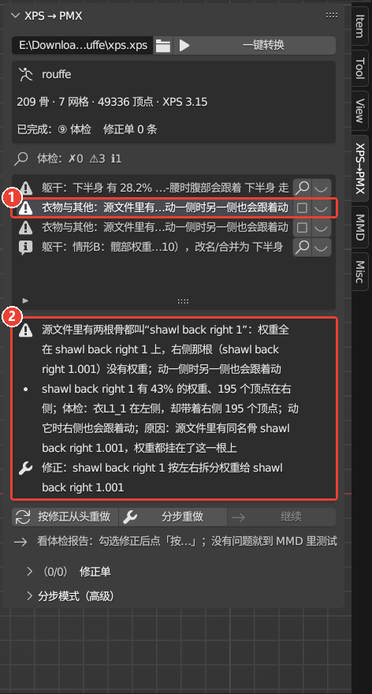

## 4. 勾选修正，从头重做

1. 点那一行右边的**勾选框**（①）。
   - 会改源权重的修正（比如这里的拆分），要你自己勾。
   - 明确的问题插件已经自动修好了，比如辅助骨并错了段，报告里标「已自动修正」，不用勾。
2. 勾上后，面板下面会提示「修正单改过，点「按修正从头重做」才生效」（③）。
3. 点 **按修正从头重做**（②）。插件会：
   - 删掉这个模型生成的所有对象；
   - 重新导入同一个 XPS；
   - 带着修正和选项一直做到 ⑨ 体检；
   - 和上一次的报告对比。

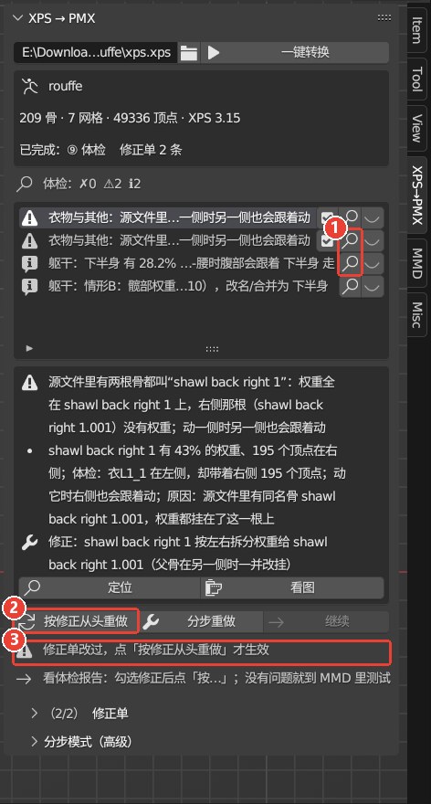

## 5. 修正单

展开主面板下面的 **修正单**（①），能看到所有修正（②）：

- 勾选框：取消勾选就是撤销，下次重做时生效；
- 括号里是来源：体检、手改、映射CSV、文件；自动加入的会标「自动」；
- X：删除这一条。自动修正只会撤销、保留记录，所以不会再被自动加回来。

导出 PMX 时，修正单会自动保存，**下次转换同一个 XPS 时自动套用**，批量脚本也一样。面板最下面的「导入」「导出」可以手动存取修正单。

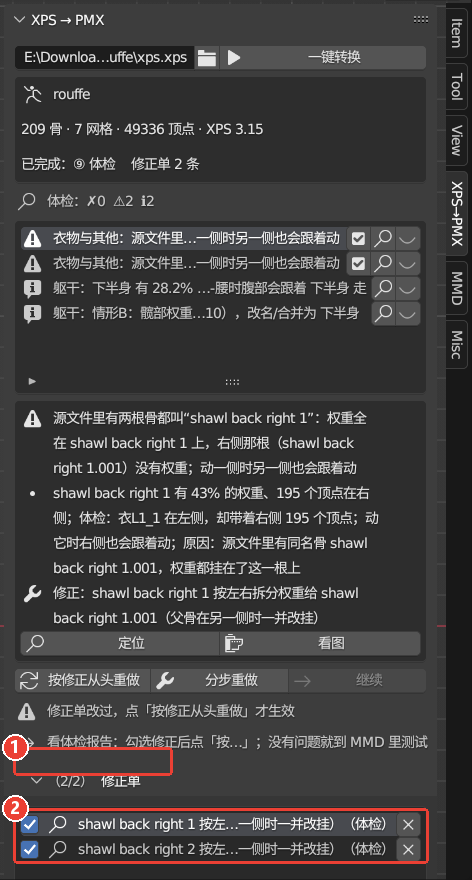

## 6. 重做之后

- 计数后面写着「比上次修好 2」（①），修好的两条标成「**已修复**」（②）。
- 剩下的「下半身 有 28.2% 的权重在腰节以上」是一条要你判断的警告。在 MMD 里扭腰时看看肚子会不会跟着胯走，再决定要不要处理，参见 [M4 测试清单](test/M4_MMD测试清单.md) 第 4 节。确认没问题，就点那一行的眼睛把它忽略。

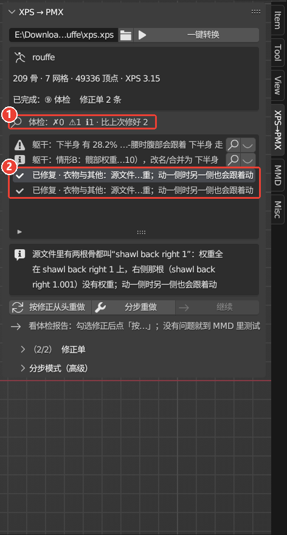

导出的文件在 `D:\xps_exports\<模型名>\`：

| 文件 | 内容 |
|---|---|
| `<模型名>.pmx` | 拿到 MMD 里用的模型 |
| `textures\` | 复制过来的贴图 |
| `<模型名>.report.json` | 各阶段的报告和体检结果 |
| `<模型名>.fixes.json` | 修正单和这个模型的选项 |

「分步模式」→「⑧ 导出 PMX」面板里的文件夹图标可以直接打开这个目录。

## 7. 自己改映射：分步重做

体检没法自动修，或者你想自己决定某根骨去哪，就用分步重做。

1. 点 **分步重做**。它也是从头导入、带上修正单，但停在 ②：模型还是原来的 T 姿势，主面板显示 ② 的结果，**继续** 按钮可以点了（①）。
2. 展开 **分步模式（高级）**（②）。

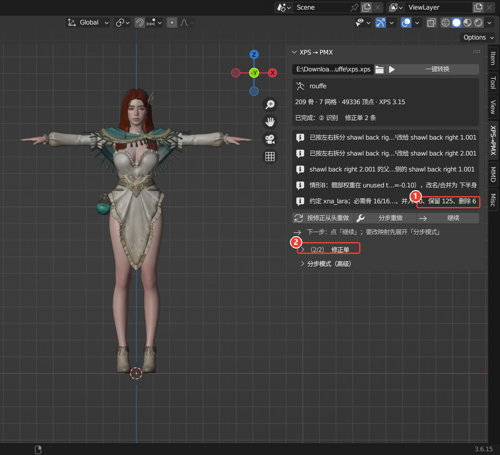

分步模式里，最上面是：

- ①「① 只导入」：只导入、不往下做，一般用不到；
- ②「② 自动识别」「检查映射」：重新识别；手改以后点「检查映射」重新检查；
- ③ 映射 CSV 的三个图标：
  - 导入：和当前结果不同的行记进修正单；
  - 导出；
  - 清除手改：回到全自动识别。

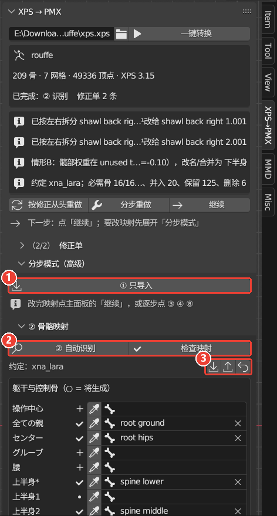

### 7.1 改槽位

往下滚是槽位表，每一行是一根 MMD 骨，名字后面带 `*` 的是必需骨。

- ① 状态图标：

  | 图标 | 意思 |
  |---|---|
  | ✓ | 已映射 |
  | ＋ | 将由 ④ 生成 |
  | · | 不生成 |
  | ⚠ / ✗ | 有问题 |
  | ✎ | 你手改过 |

- ② 吸管：先在视口的姿态模式里选中正确的骨，再点吸管把它填进来。
- ③ 骨名框：点开可以搜索骨名；鼠标停在框上按 Backspace 清空，表示这根骨交给 ④ 生成。

改过的槽位会自动记进修正单。

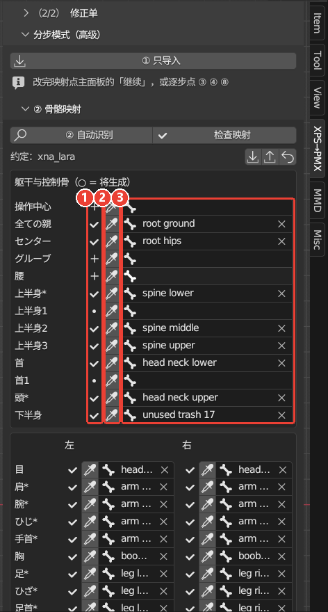

### 7.2 下半身诊断和其余骨骼

再往下：

- ① **下半身诊断**：源骨架的髋部属于哪种情形（A–D），以及 ④ 会怎样构造 下半身。
- ② **其余骨骼**的筛选：未映射的、并入、保留、删除、全部。每行可以改处置和并入目标；目标显示的是槽位 id，比如 `left_knee_bone` 就是 左ひざ。
- ③ 选中那一行的**理由**。比如 rouffe 的 `unused bip001 lcalftwist`：头在大腿段，但 100% 的明确权重在小腿段，所以按权重并入 左ひざ。

再下面的 ③ 预处理、④ 生成 MMD 骨架、⑧ 导出 PMX 三个面板里是各阶段的选项：缩放、A 姿势、准标准骨、IK 参数、导出路径。要换就在点「继续」之前改。

改完点「检查映射」，没有 ✗ 以后点主面板的 **继续**（第 7 节第一张图的 ①），插件会做完 ③ ④ ⑧ ⑨。

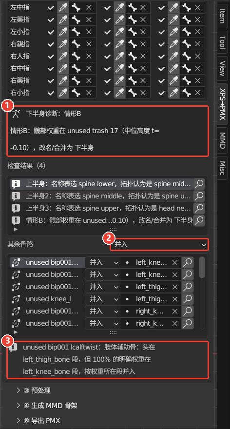

## 8. 生成骨架以后，映射是只读的

④ 做完以后，② 面板会锁定成只读，并提示「要改映射：点主面板的「分步重做」」（①）。

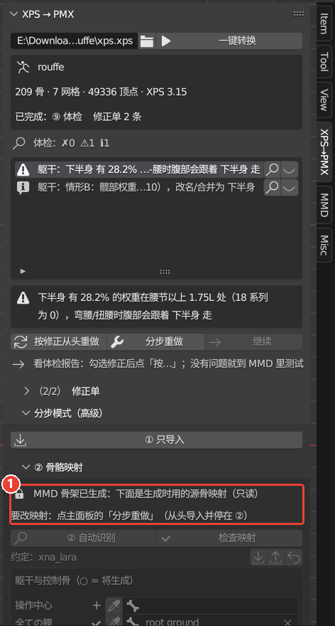

## 9. 速查

| 想做什么 | 怎么做 |
|---|---|
| 转换一个新模型 | 选 XPS 文件 → 一键转换 |
| 修体检报的问题 | 勾上修正 → 按修正从头重做 |
| 撤销一条修正 | 修正单里取消勾选 → 按修正从头重做 |
| 改映射，或者换 ③ / ④ 的选项 | 分步重做 → 在分步模式里改 → 继续 |
| 某条结果确认没问题 | 点那一行的眼睛（忽略） |
| 再转换一次同一个 XPS | 一键转换，上次的修正单会自动套用 |
| 一次转换很多个 | 用命令行批量脚本，见 README「批量转换」 |

## 10. 到 MMD 里测试

在 MMD 里打开 `D:\xps_exports\<模型名>\<模型名>.pmx`，测试步骤见 [M4 测试清单](test/M4_MMD测试清单.md)。

体检查不出穿模、物理效果和 MMD 特有的 IK 行为。你在 MMD 里发现问题，告诉我模型名、动作名、帧号和现象，我会把它变成新的体检项。
